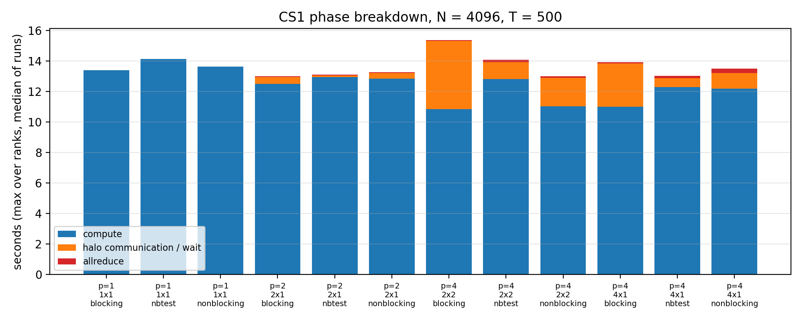

\newpage

# Appendix: full result tables

These tables are produced unedited by each case study's `analyze.py` from its `results/raw.log`.

## A1. Case Study 1 — Heat diffusion

### Verification: final grid compared byte-for-byte with serial (N=1024, T=500)

18 of 18 runs bit-identical to the serial output.

| decomposition | mode | p=1 | p=2 | p=4 |
|---|---|---|---|---|
| 1d | blocking | IDENTICAL | IDENTICAL | IDENTICAL |
| 1d | nbtest | IDENTICAL | IDENTICAL | IDENTICAL |
| 1d | nonblocking | IDENTICAL | IDENTICAL | IDENTICAL |
| 2d | blocking | IDENTICAL | IDENTICAL | IDENTICAL |
| 2d | nbtest | IDENTICAL | IDENTICAL | IDENTICAL |
| 2d | nonblocking | IDENTICAL | IDENTICAL | IDENTICAL |

### Strong scaling, N = 1024, T = 500, K = 50 (median of 5 runs; serial 1.050 s)

| dims | halo mode | p | median (s) | min (s) | S median | E median | S min | E min | compute (s) | halo comm (s) | allreduce (s) | halo values/rank/step |
|---|---|---|---|---|---|---|---|---|---|---|---|---|
| serial | - | 1 | 1.050 | 0.875 | 1.00 | 1.00 | 1.00 | 1.00 | 1.050 | 0 | 0 | 0 |
| 1x1 | blocking | 1 | 0.886 | 0.863 | 1.19 | 1.19 | 1.01 | 1.01 | 0.885 | 0.001 | 0.0000 | 0 |
| 1x1 | nbtest | 1 | 0.879 | 0.875 | 1.20 | 1.20 | 1.00 | 1.00 | 0.876 | 0.002 | 0.0000 | 0 |
| 1x1 | nonblocking | 1 | 0.898 | 0.871 | 1.17 | 1.17 | 1.00 | 1.00 | 0.896 | 0.002 | 0.0000 | 0 |
| 2x1 | blocking | 2 | 0.924 | 0.823 | 1.14 | 0.57 | 1.06 | 0.53 | 0.836 | 0.089 | 0.0054 | 1,024 |
| 2x1 | nbtest | 2 | 0.818 | 0.806 | 1.28 | 0.64 | 1.09 | 0.54 | 0.781 | 0.041 | 0.0087 | 1,024 |
| 2x1 | nonblocking | 2 | 0.836 | 0.814 | 1.26 | 0.63 | 1.08 | 0.54 | 0.783 | 0.063 | 0.0002 | 1,024 |
| 2x2 | blocking | 4 | 2.672 | 2.385 | 0.39 | 0.10 | 0.37 | 0.09 | 0.538 | 2.155 | 0.0367 | 1,024 |
| 2x2 | nbtest | 4 | 1.389 | 1.365 | 0.76 | 0.19 | 0.64 | 0.16 | 0.607 | 0.781 | 0.0423 | 1,024 |
| 2x2 | nonblocking | 4 | 1.829 | 1.696 | 0.57 | 0.14 | 0.52 | 0.13 | 0.588 | 1.280 | 0.0342 | 1,024 |
| 4x1 | blocking | 4 | 2.055 | 1.996 | 0.51 | 0.13 | 0.44 | 0.11 | 0.578 | 1.586 | 0.0335 | 2,048 |
| 4x1 | nbtest | 4 | 1.203 | 1.103 | 0.87 | 0.22 | 0.79 | 0.20 | 0.635 | 0.601 | 0.0376 | 2,048 |
| 4x1 | nonblocking | 4 | 1.224 | 1.221 | 0.86 | 0.21 | 0.72 | 0.18 | 0.618 | 0.674 | 0.0332 | 2,048 |

### Strong scaling, N = 4096, T = 500, K = 50 (median of 3 runs; serial 13.792 s)

| dims | halo mode | p | median (s) | min (s) | S median | E median | S min | E min | compute (s) | halo comm (s) | allreduce (s) | halo values/rank/step |
|---|---|---|---|---|---|---|---|---|---|---|---|---|
| serial | - | 1 | 13.792 | 13.762 | 1.00 | 1.00 | 1.00 | 1.00 | 13.792 | 0 | 0 | 0 |
| 1x1 | blocking | 1 | 13.399 | 13.398 | 1.03 | 1.03 | 1.03 | 1.03 | 13.398 | 0.001 | 0.0001 | 0 |
| 1x1 | nbtest | 1 | 14.123 | 13.579 | 0.98 | 0.98 | 1.01 | 1.01 | 14.119 | 0.003 | 0.0000 | 0 |
| 1x1 | nonblocking | 1 | 13.627 | 13.480 | 1.01 | 1.01 | 1.02 | 1.02 | 13.624 | 0.002 | 0.0000 | 0 |
| 2x1 | blocking | 2 | 12.963 | 12.626 | 1.06 | 0.53 | 1.09 | 0.54 | 12.505 | 0.434 | 0.0472 | 4,096 |
| 2x1 | nbtest | 2 | 13.037 | 12.602 | 1.06 | 0.53 | 1.09 | 0.55 | 12.949 | 0.085 | 0.0582 | 4,096 |
| 2x1 | nonblocking | 2 | 13.129 | 12.538 | 1.05 | 0.53 | 1.10 | 0.55 | 12.827 | 0.366 | 0.0591 | 4,096 |
| 2x2 | blocking | 4 | 15.141 | 13.788 | 0.91 | 0.23 | 1.00 | 0.25 | 10.836 | 4.462 | 0.0636 | 4,096 |
| 2x2 | nbtest | 4 | 13.617 | 13.572 | 1.01 | 0.25 | 1.01 | 0.25 | 12.802 | 1.110 | 0.1562 | 4,096 |
| 2x2 | nonblocking | 4 | 12.916 | 12.698 | 1.07 | 0.27 | 1.08 | 0.27 | 11.011 | 1.888 | 0.0893 | 4,096 |
| 4x1 | blocking | 4 | 13.569 | 13.502 | 1.02 | 0.25 | 1.02 | 0.25 | 10.990 | 2.842 | 0.0752 | 8,192 |
| 4x1 | nbtest | 4 | 12.701 | 12.378 | 1.09 | 0.27 | 1.11 | 0.28 | 12.273 | 0.580 | 0.1682 | 8,192 |
| 4x1 | nonblocking | 4 | 13.085 | 12.840 | 1.05 | 0.26 | 1.07 | 0.27 | 12.181 | 1.017 | 0.2814 | 8,192 |

### Surface-to-volume per rank per step (formula vs. what the code exchanged)

| N | p | decomposition | cells/rank N^2/p | halo values/rank (formula) | halo (measured, max rank) | halo / cells |
|---|---|---|---|---|---|---|
| 1024 | 2 | 2x1 (1-D rows) | 524,288 | 2,048 | 1,024 | 0.0039 |
| 1024 | 4 | 2x2 (2-D blocks) | 262,144 | 2,048 | 1,024 | 0.0078 |
| 1024 | 4 | 4x1 (1-D rows) | 262,144 | 2,048 | 2,048 | 0.0078 |
| 4096 | 2 | 2x1 (1-D rows) | 8,388,608 | 8,192 | 4,096 | 0.0010 |
| 4096 | 4 | 2x2 (2-D blocks) | 4,194,304 | 8,192 | 4,096 | 0.0020 |
| 4096 | 4 | 4x1 (1-D rows) | 4,194,304 | 8,192 | 8,192 | 0.0020 |

Formula: 1-D interior block receives 2 rows of N values; 2-D interior block receives 4 edges of N/sqrt(p). Edge blocks receive fewer (no neighbour beyond the boundary), which is why the measured maximum can be below the interior-block formula at small p.

### Blocking vs non-blocking (overlap), median times

| N | dims | p | blocking total (s) | blocking halo comm (s) | nonblocking total (s) | nonblocking wait (s) | nbtest total (s) | nbtest comm (s) | time saved by nonblocking |
|---|---|---|---|---|---|---|---|---|---|
| 1024 | 1x1 | 1 | 0.886 | 0.001 | 0.898 | 0.002 | 0.879 | 0.002 | -1.4% |
| 1024 | 2x1 | 2 | 0.924 | 0.089 | 0.836 | 0.063 | 0.818 | 0.041 | +9.5% |
| 1024 | 2x2 | 4 | 2.672 | 2.155 | 1.829 | 1.280 | 1.389 | 0.781 | +31.5% |
| 1024 | 4x1 | 4 | 2.055 | 1.586 | 1.224 | 0.674 | 1.203 | 0.601 | +40.4% |
| 4096 | 1x1 | 1 | 13.399 | 0.001 | 13.627 | 0.002 | 14.123 | 0.003 | -1.7% |
| 4096 | 2x1 | 2 | 12.963 | 0.434 | 13.129 | 0.366 | 13.037 | 0.085 | -1.3% |
| 4096 | 2x2 | 4 | 15.141 | 4.462 | 12.916 | 1.888 | 13.617 | 1.110 | +14.7% |
| 4096 | 4x1 | 4 | 13.569 | 2.842 | 13.085 | 1.017 | 12.701 | 0.580 | +3.6% |

### Model T_p ~ T_serial/p + T_comm  (2-D, non-blocking; T_comm = measured halo + allreduce)

| N | p | measured T_p (s) | T_serial/p (s) | T_comm (s) | model (s) | E median | E < 70%? |
|---|---|---|---|---|---|---|---|
| 1024 | 1 | 0.898 | 1.050 | 0.002 | 1.052 | 1.17 | no |
| 1024 | 2 | 0.836 | 0.525 | 0.063 | 0.588 | 0.63 | yes |
| 1024 | 4 | 1.829 | 0.263 | 1.314 | 1.577 | 0.14 | yes |
| 4096 | 1 | 13.627 | 13.792 | 0.002 | 13.794 | 1.01 | no |
| 4096 | 2 | 13.129 | 6.896 | 0.425 | 7.321 | 0.53 | yes |
| 4096 | 4 | 12.916 | 3.448 | 1.977 | 5.425 | 0.27 | yes |

### Convergence-check cost: K = 1 vs K = 50 (median)

| N | version | p | time K=1 (s) | time K=50 (s) | K=1 / K=50 | compute K=1 | compute K=50 | allreduce K=1 | allreduce K=50 |
|---|---|---|---|---|---|---|---|---|---|
| 1024 | serial | 1 | 2.029 | 1.344 | 1.51 | 2.029 | 1.344 | 0.0000 | 0.0000 |
| 1024 | parallel | 2 | 1.838 | 0.901 | 2.04 | 1.606 | 0.843 | 0.0197 | 0.0025 |
| 1024 | parallel | 4 | 4.676 | 2.905 | 1.61 | 1.329 | 0.740 | 1.8307 | 0.0386 |
| 4096 | serial | 1 | 34.268 | 17.116 | 2.00 | 34.268 | 17.116 | 0.0000 | 0.0000 |
| 4096 | parallel | 2 | 23.342 | 15.382 | 1.52 | 22.239 | 14.931 | 0.1023 | 0.0605 |
| 4096 | parallel | 4 | 26.491 | 14.776 | 1.79 | 21.002 | 11.923 | 2.7728 | 0.0947 |

### Weak scaling (2-D, non-blocking): N_p = N0*sqrt(p), cells per rank constant

| p | N_p | cells/rank | T_p median (s) | T_p min (s) | serial on N_p (s) | weak efficiency T_1/T_p | speedup vs serial on same N |
|---|---|---|---|---|---|---|---|
| 1 | 2048 | 4,194,304 | 3.858 | 3.704 | 3.837 | 1.00 | 0.99 |
| 2 | 2896 | 4,193,408 | 7.058 | 6.913 | 10.764 | 0.55 | 1.53 |
| 4 | 4096 | 4,194,304 | 19.196 | 14.322 | 17.849 | 0.20 | 0.93 |

{width=90%}

*CS1 phase breakdown, N = 4096 (median of 3 runs).*

## A2. Case Study 2 — k-mer counting

### Correctness (L = 1e8, every bin compared with the serial histogram)

| dist | k | version | p | total counted | expected L-k+1 | lost | wrong bins | result |
|---|---|---|---|---|---|---|---|---|
| uniform | 8 | A | 2 | 99,974,980 | 99,999,993 | 25,013 | 20,748 | FAIL |
| uniform | 8 | A | 4 | 99,967,037 | 99,999,993 | 32,956 | 25,905 | FAIL |
| uniform | 8 | B | 2 | 99,999,993 | 99,999,993 | 0 | 0 | PASS |
| uniform | 8 | B | 4 | 99,999,993 | 99,999,993 | 0 | 0 | PASS |
| uniform | 8 | C | 2 | 99,999,993 | 99,999,993 | 0 | 0 | PASS |
| uniform | 8 | C | 4 | 99,999,993 | 99,999,993 | 0 | 0 | PASS |
| uniform | 8 | N | 2 | 99,999,986 | 99,999,993 | 7 | 7 | FAIL |
| uniform | 8 | N | 4 | 99,999,972 | 99,999,993 | 21 | 21 | FAIL |
| uniform | 12 | A | 2 | 99,999,985 | 99,999,989 | 4 | 4 | FAIL |
| uniform | 12 | A | 4 | 99,999,982 | 99,999,989 | 7 | 7 | FAIL |
| uniform | 12 | B | 2 | 99,999,989 | 99,999,989 | 0 | 0 | PASS |
| uniform | 12 | B | 4 | 99,999,989 | 99,999,989 | 0 | 0 | PASS |
| uniform | 12 | C | 2 | 99,999,989 | 99,999,989 | 0 | 0 | PASS |
| uniform | 12 | C | 4 | 99,999,989 | 99,999,989 | 0 | 0 | PASS |
| uniform | 12 | N | 2 | 99,999,978 | 99,999,989 | 11 | 11 | FAIL |
| uniform | 12 | N | 4 | 99,999,956 | 99,999,989 | 33 | 33 | FAIL |
| skewed | 8 | A | 2 | 98,547,593 | 99,999,993 | 1,452,400 | 5,434 | FAIL |
| skewed | 8 | A | 4 | 97,982,867 | 99,999,993 | 2,017,126 | 6,035 | FAIL |
| skewed | 8 | B | 2 | 99,999,993 | 99,999,993 | 0 | 0 | PASS |
| skewed | 8 | B | 4 | 99,999,993 | 99,999,993 | 0 | 0 | PASS |
| skewed | 8 | C | 2 | 99,999,993 | 99,999,993 | 0 | 0 | PASS |
| skewed | 8 | C | 4 | 99,999,993 | 99,999,993 | 0 | 0 | PASS |
| skewed | 8 | N | 2 | 99,999,986 | 99,999,993 | 7 | 3 | FAIL |
| skewed | 8 | N | 4 | 99,999,972 | 99,999,993 | 21 | 17 | FAIL |
| skewed | 12 | A | 2 | 99,988,345 | 99,999,989 | 11,644 | 3,432 | FAIL |
| skewed | 12 | A | 4 | 99,983,794 | 99,999,989 | 16,195 | 4,185 | FAIL |
| skewed | 12 | B | 2 | 99,999,989 | 99,999,989 | 0 | 0 | PASS |
| skewed | 12 | B | 4 | 99,999,989 | 99,999,989 | 0 | 0 | PASS |
| skewed | 12 | C | 2 | 99,999,989 | 99,999,989 | 0 | 0 | PASS |
| skewed | 12 | C | 4 | 99,999,989 | 99,999,989 | 0 | 0 | PASS |
| skewed | 12 | N | 2 | 99,999,978 | 99,999,989 | 11 | 8 | FAIL |
| skewed | 12 | N | 4 | 99,999,956 | 99,999,989 | 33 | 30 | FAIL |

Version N cuts the sequence (not the k-mer start positions) into p pieces; it must lose exactly (p-1)(k-1) k-mers: 7/21 for k=8 and 11/33 for k=12 at p=2/4.

### Strong scaling: uniform, k = 8  (median of 7 runs; T_serial = 0.2638 s)

| version | p | median (s) | min (s) | max (s) | M k-mers/s (median) | S median | E median | S min | E min |
|---|---|---|---|---|---|---|---|---|---|
| serial | 1 | 0.2638 | 0.1897 | 0.3894 | 379 | 1.00 | 1.00 | 1.00 | 1.00 |
| B | 1 | 1.1187 | 0.9915 | 1.3009 | 89 | 0.24 | 0.24 | 0.19 | 0.19 |
| B | 2 | 1.0446 | 0.9760 | 1.2040 | 96 | 0.25 | 0.13 | 0.19 | 0.10 |
| B | 4 | 0.8438 | 0.8328 | 1.2478 | 119 | 0.31 | 0.08 | 0.23 | 0.06 |
| C | 1 | 0.2245 | 0.1992 | 0.4068 | 446 | 1.18 | 1.18 | 0.95 | 0.95 |
| C | 2 | 0.1656 | 0.1492 | 0.1754 | 604 | 1.59 | 0.80 | 1.27 | 0.64 |
| C | 4 | 0.1553 | 0.1484 | 0.1666 | 644 | 1.70 | 0.42 | 1.28 | 0.32 |

### Strong scaling: uniform, k = 12  (median of 7 runs; T_serial = 3.0156 s)

| version | p | median (s) | min (s) | max (s) | M k-mers/s (median) | S median | E median | S min | E min |
|---|---|---|---|---|---|---|---|---|---|
| serial | 1 | 3.0156 | 2.9518 | 3.0833 | 33 | 1.00 | 1.00 | 1.00 | 1.00 |
| B | 1 | 3.0564 | 2.7840 | 3.7571 | 33 | 0.99 | 0.99 | 1.06 | 1.06 |
| B | 2 | 2.0785 | 1.9606 | 2.8002 | 48 | 1.45 | 0.73 | 1.51 | 0.75 |
| B | 4 | 1.7399 | 1.6396 | 2.0567 | 57 | 1.73 | 0.43 | 1.80 | 0.45 |
| C | 1 | 3.2874 | 3.1552 | 3.5379 | 30 | 0.92 | 0.92 | 0.94 | 0.94 |
| C | 2 | 2.9002 | 2.7224 | 3.1641 | 34 | 1.04 | 0.52 | 1.08 | 0.54 |
| C | 4 | 3.1719 | 3.1185 | 3.4265 | 32 | 0.95 | 0.24 | 0.95 | 0.24 |

### Strong scaling: skewed, k = 8  (median of 7 runs; T_serial = 0.1701 s)

| version | p | median (s) | min (s) | max (s) | M k-mers/s (median) | S median | E median | S min | E min |
|---|---|---|---|---|---|---|---|---|---|
| serial | 1 | 0.1701 | 0.1578 | 0.4496 | 588 | 1.00 | 1.00 | 1.00 | 1.00 |
| B | 1 | 0.8728 | 0.8565 | 1.3832 | 115 | 0.19 | 0.19 | 0.18 | 0.18 |
| B | 2 | 0.9916 | 0.9339 | 1.0483 | 101 | 0.17 | 0.09 | 0.17 | 0.08 |
| B | 4 | 0.9253 | 0.9211 | 0.9388 | 108 | 0.18 | 0.05 | 0.17 | 0.04 |
| C | 1 | 0.1750 | 0.1594 | 0.1846 | 571 | 0.97 | 0.97 | 0.99 | 0.99 |
| C | 2 | 0.1408 | 0.1209 | 0.3115 | 710 | 1.21 | 0.60 | 1.30 | 0.65 |
| C | 4 | 0.1210 | 0.1148 | 0.2146 | 827 | 1.41 | 0.35 | 1.37 | 0.34 |

### Strong scaling: skewed, k = 12  (median of 7 runs; T_serial = 1.3168 s)

| version | p | median (s) | min (s) | max (s) | M k-mers/s (median) | S median | E median | S min | E min |
|---|---|---|---|---|---|---|---|---|---|
| serial | 1 | 1.3168 | 1.2751 | 1.7302 | 76 | 1.00 | 1.00 | 1.00 | 1.00 |
| B | 1 | 2.1613 | 2.1019 | 2.4405 | 46 | 0.61 | 0.61 | 0.61 | 0.61 |
| B | 2 | 1.4879 | 1.3972 | 1.6432 | 67 | 0.89 | 0.44 | 0.91 | 0.46 |
| B | 4 | 1.2042 | 1.1919 | 1.3801 | 83 | 1.09 | 0.27 | 1.07 | 0.27 |
| C | 1 | 1.4535 | 1.3545 | 1.7861 | 69 | 0.91 | 0.91 | 0.94 | 0.94 |
| C | 2 | 1.3730 | 1.2651 | 1.5611 | 73 | 0.96 | 0.48 | 1.01 | 0.50 |
| C | 4 | 1.4419 | 1.3646 | 1.8521 | 69 | 0.91 | 0.23 | 0.93 | 0.23 |

### Atomic (B) vs private histograms (C), uniform, median times

| k | p | B (s) | C (s) | B/C | C extra memory (p x 4^k x 4 B) |
|---|---|---|---|---|---|
| 8 | 1 | 1.1187 | 0.2245 | 4.98 | 256 KiB |
| 8 | 2 | 1.0446 | 0.1656 | 6.31 | 512 KiB |
| 8 | 4 | 0.8438 | 0.1553 | 5.44 | 1 MiB |
| 12 | 1 | 3.0564 | 3.2874 | 0.93 | 64 MiB |
| 12 | 2 | 2.0785 | 2.9002 | 0.72 | 128 MiB |
| 12 | 4 | 1.7399 | 3.1719 | 0.55 | 256 MiB |

Version C merge time (median, uniform): k=8 p=1: 0.2 ms, k=8 p=2: 0.3 ms, k=8 p=4: 3.8 ms, k=12 p=1: 65.1 ms, k=12 p=2: 57.3 ms, k=12 p=4: 61.3 ms

### False sharing (k = 1, per-thread counters in one shared array; median of 7 runs)

| p | unpadded 32 B/thread (s) | padded 128 B/thread (s) | unpadded / padded | unpadded speedup vs p=1 | padded speedup vs p=1 |
|---|---|---|---|---|---|
| 1 | 0.1264 | 0.1152 | 1.10 | 1.00 | 1.00 |
| 2 | 0.3014 | 0.0911 | 3.31 | 0.42 | 1.26 |
| 4 | 0.2070 | 0.0782 | 2.65 | 0.61 | 1.47 |

### Memory probe (membench, best of 3 rounds)

| p | sequential read GB/s | random RMW, 256 KiB table (M/s) | random RMW, 64 MiB table (M/s) |
|---|---|---|---|
| 1 | 13.39 | 340 | 35 |
| 2 | 16.42 | 517 | 37 |
| 4 | 16.62 | 594 | 34 |

## A3. Case Study 3 — Monte Carlo

### Strong scaling (M fixed)

Median of 9 interleaved runs. Speedup is relative to the serial baseline (T1 = 4.362 s). p > 2 uses hyper-threading.

| version | p | median time (s) | min | max | spread max/min | S(p) median | E(p) median | S(p) from min | E(p) from min |
|---|---|---|---|---|---|---|---|---|---|
| serial | 1 | 4.362 | 4.261 | 5.385 | 1.26 | 1.00 | 1.00 | 1.00 | 1.00 |
| parallel | 1 | 4.462 | 4.176 | 4.621 | 1.11 | 0.98 | 0.98 | 1.02 | 1.02 |
| parallel | 2 | 3.110 | 3.051 | 4.475 | 1.47 | 1.40 | 0.70 | 1.40 | 0.70 |
| parallel | 4 | 2.568 | 2.367 | 3.488 | 1.47 | 1.70 | 0.42 | 1.80 | 0.45 |

Experimentally determined serial fraction (Karp-Flatt), f = (1/S - 1/p) / (1 - 1/p):

- p = 2: f = 0.426 (median-based), 0.432 (min-based)
- p = 4: f = 0.452 (median-based), 0.407 (min-based)

Thread placement: OMP_PLACES=cores, OMP_PROC_BIND=close -> p <= 2 uses one thread per physical core; p = 4 puts two hyper-threads on each core.

### Fixed-time runs (M_p chosen to finish in the serial best time)

SE depends only on M and the seed, so it is identical in every round. Target time = serial minimum = 4.261 s.

| p | samples M | SE | SE_1 / SE_p | sqrt(M_p / M_1) | median time (s) | min time (s) | price | deviation from BS (in SE) |
|---|---|---|---|---|---|---|---|---|
| 1 | 102,043,462 | 0.0014574 | 1.000 | 1.000 | 5.023 | 4.376 | 10.451644 | 0.73 |
| 2 | 139,666,278 | 0.0012457 | 1.170 | 1.170 | 4.469 | 4.391 | 10.451464 | 0.71 |
| 4 | 180,021,974 | 0.0010971 | 1.328 | 1.328 | 5.045 | 4.369 | 10.452038 | 1.33 |

### RNG strategies

| mode | p | M | time (s) | M samples/s | price | reported SE | true SE* |
|---|---|---|---|---|---|---|---|
| jump | 4 | 100,000,000 | 2.468 | 40.52 | 10.451660 | 0.001472 | 0.001472 |
| shared | 4 | 20,000,000 | 2.234 | 8.95 | 10.452101 | 0.003292 | 0.003292 |
| sameseed | 4 | 100,000,000 | 2.437 | 41.03 | 10.452449 | 0.001472 | 0.002945 |

*sameseed: all p threads replay one stream, so only M/p samples are independent and the true SE is sqrt(p) times the reported one.

## A4. Case Study 4 — PageRank

### Graph

R-MAT scale 20 (a,b,c,d = 0.57,0.19,0.19,0.05), seed 2026: n = 1,048,576 vertices, m = 16,085,679 edges (average degree 15.34), max in-degree 39,615, max out-degree 39,581, dangling (out-degree 0) 501,933 (47.9%), isolated 401,900.

### Verification against serial ranks (tolerance: L1 distance < 1e-9)

| version | p | schedule | iterations | L1 distance to serial | result |
|---|---|---|---|---|---|
| pull | 1 | static | 24 | 0.000e+00 | PASS |
| pull | 2 | static | 24 | 5.689e-13 | PASS |
| pull | 4 | static | 24 | 9.065e-13 | PASS |
| push | 1 | static | 24 | 0.000e+00 | PASS |
| push | 2 | static | 24 | 5.688e-13 | PASS |
| push | 4 | static | 24 | 9.064e-13 | PASS |
| pushna | 1 | static | 24 | 0.000e+00 | PASS |
| pushna | 2 | static | 200 | 2.174e-03 | FAIL |
| pushna | 4 | static | 200 | 3.106e-03 | FAIL |

### Strong scaling (median of 5 runs; serial 2.713 s for 24 iterations)

| version | schedule | p | median (s) | min (s) | S median | E median | S min | M edges/s | imbalance R | edges max/mean |
|---|---|---|---|---|---|---|---|---|---|---|
| serial | - | 1 | 2.713 | 2.329 | 1.00 | 1.00 | 1.00 | 142 | 1.00 | 1.00 |
| pull | dynamic,256 | 1 | 2.531 | 2.148 | 1.07 | 1.07 | 1.08 | 153 | 1.000 | 1.000 |
| pull | dynamic,256 | 2 | 1.998 | 1.332 | 1.36 | 0.68 | 1.75 | 193 | 1.000 | 1.006 |
| pull | dynamic,256 | 4 | 1.793 | 1.347 | 1.51 | 0.38 | 1.73 | 215 | 1.011 | 1.028 |
| pull | guided | 1 | 2.391 | 2.056 | 1.13 | 1.13 | 1.13 | 161 | 1.000 | 1.000 |
| pull | guided | 2 | 2.043 | 1.968 | 1.33 | 0.66 | 1.18 | 189 | 1.132 | 1.170 |
| pull | guided | 4 | 1.903 | 1.571 | 1.43 | 0.36 | 1.48 | 203 | 1.118 | 1.140 |
| pull | static | 1 | 2.502 | 2.335 | 1.08 | 1.08 | 1.00 | 154 | 1.000 | 1.000 |
| pull | static | 2 | 2.222 | 1.733 | 1.22 | 0.61 | 1.34 | 174 | 1.385 | 1.510 |
| pull | static | 4 | 1.904 | 1.554 | 1.42 | 0.36 | 1.50 | 203 | 1.783 | 2.278 |
| push | dynamic,256 | 1 | 7.100 | 6.581 | 0.38 | 0.38 | 0.35 | 54 | 1.000 | 1.000 |
| push | dynamic,256 | 2 | 4.918 | 4.727 | 0.55 | 0.28 | 0.49 | 78 | 1.000 | 1.005 |
| push | dynamic,256 | 4 | 4.823 | 4.483 | 0.56 | 0.14 | 0.52 | 80 | 1.001 | 1.012 |
| push | guided | 1 | 7.373 | 6.266 | 0.37 | 0.37 | 0.37 | 52 | 1.000 | 1.000 |
| push | guided | 2 | 6.175 | 5.637 | 0.44 | 0.22 | 0.41 | 63 | 1.083 | 1.128 |
| push | guided | 4 | 6.099 | 5.215 | 0.44 | 0.11 | 0.45 | 63 | 1.139 | 1.141 |
| push | static | 1 | 8.602 | 6.959 | 0.32 | 0.32 | 0.33 | 45 | 1.000 | 1.000 |
| push | static | 2 | 7.806 | 6.238 | 0.35 | 0.17 | 0.37 | 49 | 1.402 | 1.511 |
| push | static | 4 | 6.144 | 5.171 | 0.44 | 0.11 | 0.45 | 63 | 1.795 | 2.279 |

### Schedule and chunk size (pull, median)

| schedule | p=2 time (s) | p=2 R | p=2 edges max/mean | p=4 time (s) | p=4 R | p=4 edges max/mean |
|---|---|---|---|---|---|---|
| static | 2.098 | 1.404 | 1.510 | 1.835 | 1.793 | 2.278 |
| static,64 | 2.093 | 1.366 | 1.511 | 1.876 | 1.739 | 2.279 |
| static,1024 | 2.020 | 1.383 | 1.511 | 2.028 | 1.761 | 2.280 |
| dynamic,1 | 2.785 | 1.000 | 1.006 | 2.619 | 1.003 | 1.014 |
| dynamic,16 | 1.891 | 1.001 | 1.001 | 1.705 | 1.011 | 1.013 |
| dynamic,64 | 1.625 | 1.000 | 1.008 | 1.700 | 1.006 | 1.023 |
| dynamic,256 | 1.922 | 1.001 | 1.010 | 1.618 | 1.005 | 1.015 |
| dynamic,1024 | 1.727 | 1.001 | 1.008 | 1.604 | 1.006 | 1.022 |
| dynamic,4096 | 1.650 | 1.000 | 1.009 | 1.995 | 1.004 | 1.026 |
| dynamic,16384 | 1.535 | 1.000 | 1.007 | 1.731 | 1.005 | 1.024 |
| guided | 1.916 | 1.030 | 1.043 | 2.070 | 1.121 | 1.219 |
| guided,64 | 1.935 | 1.049 | 1.043 | 2.122 | 1.092 | 1.137 |
| guided,256 | 1.933 | 1.100 | 1.128 | 1.973 | 1.061 | 1.136 |

### Cost of atomics (p = 1, static, median)

| version | time (s) | ns per edge per iteration |
|---|---|---|
| pull (no atomics, random reads) | 2.502 | 6.48 |
| push without atomic (random writes) | 2.829 | 7.33 |
| push with omp atomic (random atomic writes) | 6.979 | 18.08 |

Atomic overhead at p=1: 10.75 ns per edge (147% on top of the plain scatter); push/pull ratio 2.79.

## A5. Case Study 5 — Sample sort

### Ping-pong: T(m) = alpha + beta*m  (best of 3 rounds, one-way time)

| message | one-way time (us) | bandwidth (GB/s) | model alpha+beta*m (us) |
|---|---|---|---|
| 1 B | 0.27 | 0.00 | 0.29 |
| 4 B | 0.29 | 0.01 | 0.29 |
| 16 B | 0.29 | 0.05 | 0.29 |
| 64 B | 0.30 | 0.21 | 0.30 |
| 256 B | 0.36 | 0.71 | 0.34 |
| 1,024 B | 0.60 | 1.70 | 0.51 |
| 4,096 B | 3.88 | 1.06 | 1.16 |
| 16,384 B | 6.57 | 2.49 | 3.77 |
| 65,536 B | 11.93 | 5.49 | 14.21 |
| 262,144 B | 38.03 | 6.89 | 56.00 |
| 1,048,576 B | 176.42 | 5.94 | 223.12 |
| 4,194,304 B | 938.72 | 4.47 | 891.62 |
| 16,777,216 B | 3546.72 | 4.73 | 3565.61 |
| 67,108,864 B | 14445.09 | 4.65 | 14261.56 |

alpha = 0.288 us (mean of messages <= 64 B); beta = 0.2125 ns/B (= 4.71 GB/s, fit 64 KiB-16 MiB); for a 64 MiB message beta_DRAM = 0.2152 ns/B (= 4.65 GB/s).

### Load balance after redistribution: max/mean elements per rank vs oversampling ov (ov*p - 1 samples per rank)

| p | distribution | splitter rule | ov=1 | ov=4 | ov=16 | ov=64 | ov=256 |
|---|---|---|---|---|---|---|---|
| 2 | uniform | key only | 1.000 | 1.000 | 1.000 | 1.000 | 1.000 |
| 2 | uniform | key+rank+pos | 1.000 | 1.000 | 1.000 | 1.000 | 1.000 |
| 2 | zipf | key only | 1.037 | 1.037 | 1.037 | 1.037 | 1.037 |
| 2 | zipf | key+rank+pos | 1.019 | 1.019 | 1.019 | 1.003 | 1.001 |
| 4 | uniform | key only | 1.000 | 1.000 | 1.000 | 1.000 | 1.000 |
| 4 | uniform | key+rank+pos | 1.000 | 1.000 | 1.000 | 1.000 | 1.000 |
| 4 | zipf | key only | 1.532 | 1.532 | 1.532 | 1.532 | 1.532 |
| 4 | zipf | key+rank+pos | 1.073 | 1.040 | 1.007 | 1.008 | 1.001 |

Final elements per rank at ov = 1 and the largest ov:

| p | distribution | splitter rule | ov | counts per rank |
|---|---|---|---|---|
| 2 | uniform | key only | 1 | 50005926, 49994074 |
| 2 | uniform | key only | 256 | 50005926, 49994074 |
| 2 | uniform | key+rank+pos | 1 | 50005926, 49994074 |
| 2 | uniform | key+rank+pos | 256 | 50005926, 49994074 |
| 2 | zipf | key only | 1 | 51851675, 48148325 |
| 2 | zipf | key only | 256 | 51851675, 48148325 |
| 2 | zipf | key+rank+pos | 1 | 50929026, 49070974 |
| 2 | zipf | key+rank+pos | 256 | 50050119, 49949881 |
| 4 | uniform | key only | 1 | 24997591, 25002068, 25003180, 24997161 |
| 4 | uniform | key only | 256 | 24997591, 25002068, 25003180, 24997161 |
| 4 | uniform | key+rank+pos | 1 | 24997591, 25002068, 25003180, 24997161 |
| 4 | uniform | key+rank+pos | 256 | 24997591, 25002068, 25003180, 24997161 |
| 4 | zipf | key only | 1 | 38304375, 13546075, 23371255, 24778295 |
| 4 | zipf | key only | 256 | 38304375, 13546075, 23371255, 24778295 |
| 4 | zipf | key+rank+pos | 1 | 25399423, 22601964, 26814618, 25183995 |
| 4 | zipf | key+rank+pos | 256 | 24984383, 25034323, 24973856, 25007438 |

### uniform, local sort = qsort: time and phase breakdown (median of 3 runs; N = 100,000,000)

| version | p | total (s) | min (s) | speedup | efficiency | local sort | sampling | partition | alltoall(v) | merge | max/mean count | verified |
|---|---|---|---|---|---|---|---|---|---|---|---|---|
| serial (1 process) | 1 | 30.484 | 23.826 | 1.00 | 1.00 | 30.484 | – | – | – | – | – | PASS |
| sample sort | 1 | 33.904 | 22.374 | 0.90 | 0.90 | 33.623 | 0.000 | 0.000 | 0.287 | 0.000 | 1.000 | PASS |
| sample sort | 2 | 19.973 | 19.632 | 1.53 | 0.76 | 19.198 | 0.000 | 0.000 | 0.246 | 0.635 | 1.000 | PASS |
| sample sort | 4 | 19.649 | 11.457 | 1.55 | 0.39 | 18.214 | 0.001 | 0.000 | 0.171 | 0.583 | 1.000 | PASS |

### uniform, local sort = radix: time and phase breakdown (median of 3 runs; N = 100,000,000)

| version | p | total (s) | min (s) | speedup | efficiency | local sort | sampling | partition | alltoall(v) | merge | max/mean count | verified |
|---|---|---|---|---|---|---|---|---|---|---|---|---|
| serial (1 process) | 1 | 2.219 | 1.428 | 1.00 | 1.00 | 2.219 | – | – | – | – | – | PASS |
| sample sort | 1 | 2.651 | 1.721 | 0.84 | 0.84 | 2.107 | 0.000 | 0.000 | 0.351 | 0.000 | 1.000 | PASS |
| sample sort | 2 | 2.598 | 2.347 | 0.85 | 0.43 | 1.534 | 0.000 | 0.000 | 0.301 | 0.763 | 1.000 | PASS |
| sample sort | 4 | 3.105 | 2.957 | 0.71 | 0.18 | 1.744 | 0.020 | 0.011 | 0.342 | 1.321 | 1.000 | PASS |

### zipf, local sort = qsort: time and phase breakdown (median of 3 runs; N = 100,000,000)

| version | p | total (s) | min (s) | speedup | efficiency | local sort | sampling | partition | alltoall(v) | merge | max/mean count | verified |
|---|---|---|---|---|---|---|---|---|---|---|---|---|
| serial (1 process) | 1 | 22.563 | 19.265 | 1.00 | 1.00 | 22.563 | – | – | – | – | – | PASS |
| sample sort | 1 | 18.637 | 13.406 | 1.21 | 1.21 | 18.350 | 0.000 | 0.000 | 0.303 | 0.000 | 1.000 | PASS |
| sample sort | 2 | 15.546 | 13.931 | 1.45 | 0.73 | 14.999 | 0.000 | 0.000 | 0.218 | 0.328 | 1.019 | PASS |
| sample sort | 4 | 12.047 | 7.667 | 1.87 | 0.47 | 11.406 | 0.000 | 0.000 | 0.239 | 0.402 | 1.073 | PASS |

### zipf, local sort = radix: time and phase breakdown (median of 3 runs; N = 100,000,000)

| version | p | total (s) | min (s) | speedup | efficiency | local sort | sampling | partition | alltoall(v) | merge | max/mean count | verified |
|---|---|---|---|---|---|---|---|---|---|---|---|---|
| serial (1 process) | 1 | 2.176 | 1.878 | 1.00 | 1.00 | 2.176 | – | – | – | – | – | PASS |
| sample sort | 1 | 2.087 | 1.986 | 1.04 | 1.04 | 1.773 | 0.000 | 0.000 | 0.314 | 0.000 | 1.000 | PASS |
| sample sort | 2 | 1.863 | 1.735 | 1.17 | 0.58 | 1.378 | 0.000 | 0.000 | 0.239 | 0.246 | 1.019 | PASS |
| sample sort | 4 | 1.769 | 1.342 | 1.23 | 0.31 | 0.936 | 0.001 | 0.000 | 0.334 | 0.410 | 1.073 | PASS |

### Alltoallv: model (p-1)*alpha + beta*bytes vs measured (median)

| dist | sort | p | max bytes sent by one rank to others | predicted, beta fit (s) | predicted, beta_DRAM (s) | measured (s) |
|---|---|---|---|---|---|---|
| uniform | qsort | 2 | 95.4 MiB | 0.021 | 0.022 | 0.246 |
| uniform | qsort | 4 | 71.5 MiB | 0.016 | 0.016 | 0.171 |
| uniform | radix | 2 | 95.4 MiB | 0.021 | 0.022 | 0.301 |
| uniform | radix | 4 | 71.5 MiB | 0.016 | 0.016 | 0.342 |
| zipf | qsort | 2 | 95.4 MiB | 0.021 | 0.022 | 0.218 |
| zipf | qsort | 4 | 82.4 MiB | 0.018 | 0.019 | 0.239 |
| zipf | radix | 2 | 95.4 MiB | 0.021 | 0.022 | 0.239 |
| zipf | radix | 4 | 82.4 MiB | 0.018 | 0.019 | 0.334 |
