# 1. Introduction

**Team.** This group has a single member, Asad Usman (23L-0740), who led and ran all five case studies (Section 8).
All code, measurements, graphs and raw logs are in the repository `Group02_Assignment3`. Each case-study directory
regenerates its results with `./bench.sh && python3 analyze.py`.

| item | value |
|---|---|
| CPU | Intel Core i5-7300U @ 2.60 GHz (Kaby Lake, 15 W, turbo on): **2 physical cores, 4 logical** (CPUs 0/1 share core 0, 2/3 share core 1) |
| caches / memory | L1d 32 KiB and L2 256 KiB per core, L3 3 MiB shared; 9.7 GiB visible to Linux; measured read bandwidth 13.4 GB/s (1 core), 16.6 GB/s (all cores) |
| OS | Ubuntu 26.04.1 LTS under WSL2 (Hyper-V virtual machine on Windows) |
| toolchain | GCC 15.2.0, `-O3 -march=native -std=c11` for every serial and parallel version; Open MPI 5.0.10; Python 3 + matplotlib for graphs |

**How timings were taken.** Only the parallel work is timed: `omp_get_wtime`/`clock_gettime` for OpenMP, and
`MPI_Wtime` between `MPI_Barrier`s for MPI, reporting the slowest rank. Input generation and I/O are excluded.
Every configuration was run **3–9 times (stated per table)**, interleaved (serial, p=1, 2, 4, serial, …) with a
cool-down between runs, so that slow drift in clock speed affects all configurations alike. We report the
**median**. This laptop's clock varies strongly with temperature and turbo state (identical serial runs varied by up
to 3.8× in an early run), so we also report the **minimum** and say which we trust where they disagree. Threads are
placed one per core first (`OMP_PLACES=cores OMP_PROC_BIND=close`; MPI `--bind-to core` for p ≤ 2). With only 2
physical cores, **p = 4 means hyper-threading (OpenMP) or oversubscription (MPI, `--map-by :OVERSUBSCRIBE`)**. It
is shaded in every graph, and speedups above 2 are not expected.

# 2. Case Study 1 — Heat Diffusion (MPI)

**Problem.** A 5-point explicit stencil, u′ = u + α(Σ neighbours − 4u) with α = 0.2, on an N × N grid (N = 1024 and
4096) for T = 500 steps. The boundary is fixed (100/75/50/0) and the interior starts at 0. Each step reads only the
previous grid, so all cells update in parallel. Blocks need one halo layer per step, plus a global max-change
reduction every K steps.

**Model and decomposition.** MPI on a Cartesian topology (`MPI_Cart_create`, `MPI_Cart_shift`). Dims p × 1 give
**1-D row blocks**, and `MPI_Dims_create` gives **2-D blocks** (2 × 2 at p = 4). Each rank stores its block plus a
ghost ring. Rows are sent contiguously and columns as an `MPI_Type_vector`. There are three halo modes:
`blocking` (4 × `MPI_Sendrecv`), `nonblocking` (Irecv/Isend, update the inner cells, `Waitall`, then update the outer
frame), and `nbtest` (as nonblocking, plus `MPI_Testall` every 16 rows to drive progress). The convergence metric is
`MPI_Allreduce(MAX)` every K steps.

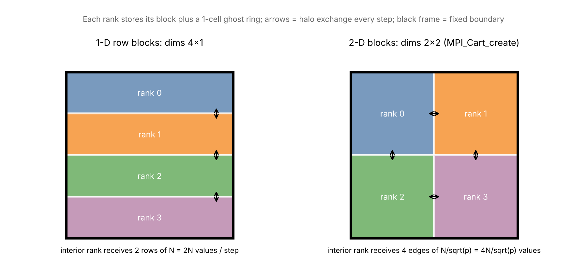{width=60%}

**Correctness.** All versions share one `STENCIL()` macro, and `-std=c11` disables FMA contraction, so the
arithmetic is identical. The final grid is written with MPI-IO and compared **byte for byte** with the serial output
(`cmp`): **18/18 variants identical** (1-D/2-D × 3 modes × p = 1, 2, 4).

| N | dims, mode | p | time (s) | speedup | compute (s) | halo comm/wait (s) |
|---|---|---|---|---|---|---|
| 4096 | serial | 1 | 13.792 | 1.00 | 13.792 | – |
| 4096 | 2×1 nonblocking | 2 | 13.129 | 1.05 | 12.827 | 0.366 |
| 4096 | 2×2 nonblocking | 4 | 12.916 | 1.07 | 11.011 | 1.888 |
| 1024 | serial | 1 | 1.050 | 1.00 | 1.050 | – |
| 1024 | 2×1 nbtest | 2 | 0.818 | **1.28** | 0.781 | 0.041 |
| 1024 | 4×1 nonblocking | 4 | 1.224 | 0.86 | 0.618 | 0.674 |

*Median of 5 (N = 1024) / 3 (N = 4096) runs. Weak scaling, N_p = 2048·√p: efficiency 1.00 / **0.55** / 0.20 at
p = 1 / 2 / 4. Graphs: strong scaling (both N) and weak scaling.*

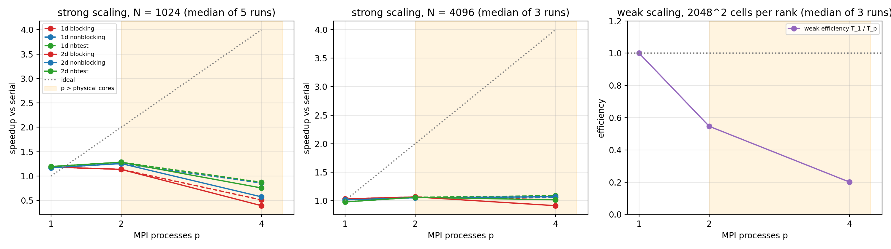{width=100%}

**The key finding: the stencil is memory-bandwidth-bound.** The compute phase contains no communication, yet at
N = 4096 each of 2 ranks spends 12.5–12.8 s on *half* the grid, almost serial's 13.8 s for the whole grid. Each
update streams 16–24 B (read u, write v, write-allocate). Serial already performs 608 M updates/s = 9.7–14.6 GB/s,
which is this machine's measured bandwidth.

**Q1 Surface-to-volume.** Per step, a rank does N²/p updates and receives a halo of 2N values (1-D) or 4N/√p (2-D).
2-D sends less only for √p > 2, i.e. **p > 4**. Adding latency (2 vs 4 messages): T₁D = 2α + 16Nβ and
T₂D = 4α + 32(N/√p)β, so 2-D needs p > 4 *and* large N. At p = 4 the measured maximum halo was 4 096 (2×2) vs 8 192
(4×1) doubles at N = 4096, yet 2×2 was not faster (12.92 vs 13.09 s). The halo is ≤ 64 KiB per step against
≈ 268 MB of grid traffic, so halo volume is not our bottleneck.

**Q2 Overlap.** At p = 2, nonblocking saved 9.5% at N = 1024 (0.924 → 0.836 s) and nothing at N = 4096, where
communication is only 3% of the run. Overlap does not happen on its own. Open MPI moves a 32 KiB row with a
rendezvous protocol that only progresses inside MPI calls, so with plain `nonblocking` the halo wait was still
0.366 s. Polling with `MPI_Testall` (`nbtest`) cut it to **0.085 s (−77%)**. The transfer then really ran under the
computation, but the total did not improve, because that computation is bandwidth-bound. The 15–41% gains at p = 4
come from oversubscription: blocked ranks busy-poll and steal the core from their partner.

**Q3 Efficiency below 70%.** This happens **already at p = 2** (E = 0.63 at N = 1024, 0.53 at N = 4096). The model
T_p ≈ T_serial/p + T_comm predicts 7.32 s for N = 4096, p = 2, against 13.13 s measured, because it assumes compute
shrinks with p. A bandwidth-aware model, T_p ≈ max(T_serial/p, 24 B · cells · T / BW(p)) + T_comm with BW from our
`membench`, gives **12.69 s (p = 2)**, close to the measurement. It also bounds weak efficiency at
BW(2)/(2·BW(1)) = 0.61 (measured 0.55).

**Q4 Convergence check.** K = 1 is 1.5–2.0× slower than K = 50, *even in serial* (34.3 vs 17.1 s at N = 4096). GCC's
`-fopt-info-vec` shows the plain update loop is vectorized and the max-tracking loop is not (without `-ffast-math`
it may not vectorize a floating-point max). The `MPI_Allreduce` itself costs 0.02–0.10 s per 500 steps at p = 2 but
1.8–2.8 s at p = 4, where every step becomes a global synchronization point among oversubscribed ranks.

# 3. Case Study 2 — k-mer Counting (OpenMP)

**Problem.** Count all k-mers (k = 8: 4⁸ bins = 256 KiB; k = 12: 64 MiB) of a synthetic 10⁸-base sequence (seed 2026),
**uniform** or **skewed** (A 0.55, C 0.05, G 0.05, T 0.35). Bases are 2-bit codes, so a rolling 2k-bit window is the
histogram index. Positions are independent; they meet only in shared counters (a histogram reduction).

**Decomposition.** The k-mer **start positions** 0…L−k are split into p contiguous chunks
(`omp parallel for schedule(static)`). Each chunk primes its window with k − 1 bases, reading into its neighbour's
chunk (read-only), so every k-mer is counted exactly once. Versions: **A** shared histogram with no protection
(race), **B** `omp atomic`, **C** private histograms plus a parallel merge over bins.

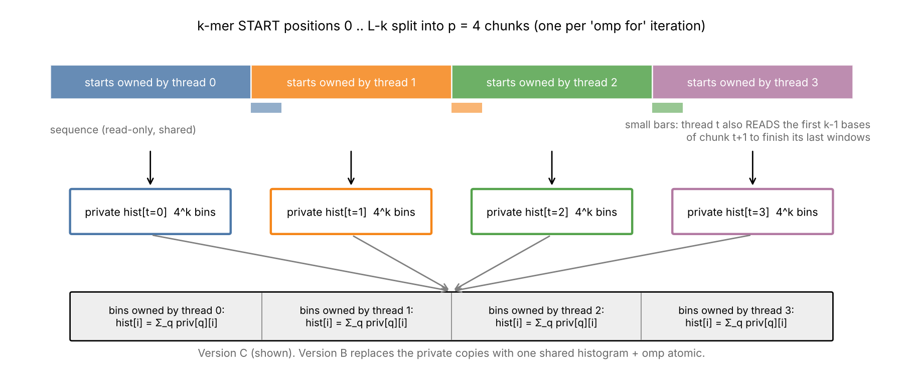{width=62%}

**Correctness.** Every bin was compared with the serial histogram at L = 10⁸: **B and C exact (0 wrong bins) in all
16 configurations**. A deliberately wrong version N, which cuts the *sequence* instead of the start positions, loses
exactly (p−1)(k−1) k-mers (11/33 for k = 12, p = 2/4), which proves boundary handling matters.

| dist, k | serial (s) | B speedup p=1/2/4 | C speedup p=1/2/4 | best throughput |
|---|---|---|---|---|
| uniform, 8 | 0.264 | 0.24 / 0.25 / 0.31 | 1.18 / 1.59 / **1.70** | C p=4: 644 M k-mers/s |
| uniform, 12 | 3.016 | 0.99 / 1.45 / **1.73** | 0.92 / 1.04 / 0.95 | B p=4: 57 M k-mers/s |
| skewed, 8 | 0.170 | 0.19 / 0.17 / 0.18 | 0.97 / 1.21 / **1.41** | C p=4: 827 M k-mers/s |

*Median of 7 runs.*

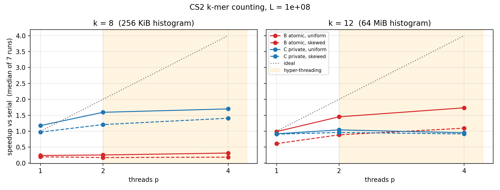{width=78%}

**Q1 Version A.** `hist[c]++` is a load–add–store, so two threads can both store old+1 and one increment is lost.
Uniform k = 8 at p = 2 counted 99 974 980 k-mers instead of 99 999 993 (**25 013 lost**, 20 748 wrong bins). The loss
depends on how often threads collide on the same bin: only **4–7** per 10⁸ for uniform k = 12 (16.8 M bins), small
enough to pass a casual test; **2.0 M** for skewed k = 8 at p = 4, where AAAAAAAA alone receives ≈ 0.8% of all
increments.

**Q2 Atomic vs private: a crossover.** At **k = 8, C is 5–6× faster than B**. Private 256 KiB histograms stay in each
core's L2, while every atomic is a `lock`-prefixed read-modify-write (+8.5 ns per increment even at p = 1), and the
4 096 shared lines bounce between cores. On the skewed input B gets *slower* with more threads. At **k = 12, B wins
(B/C = 0.93 / 0.72 / 0.55 at p = 1 / 2 / 4)**. Every increment is a DRAM miss anyway, which hides the atomic's cost,
while C multiplies a DRAM-resident working set. The **extra memory of C is p × 4^k × 4 B: 1 MiB at k = 8 but 256 MiB
at k = 12, p = 4**, more than the 100 MB input. Rule: private copies win while p·4^k·4 B fits in cache.

**Q3 False sharing.** With k = 1, each thread's 4 counters sit in one shared array, written through a `volatile`
pointer. Unpadded (32 B per thread), **2 threads took 0.301 s against 0.126 s for 1 (2.4× slower)**, as the shared
64-byte line bounced between cores on every increment. Padded to 128 B (to avoid Intel's adjacent-line prefetcher
pairing), 2 threads took 0.091 s, **3.3× faster** than unpadded.

**Q4 Memory-bound?** k = 8 moves ≈ 1 B of DRAM traffic per k-mer (the sequence stream; counters stay cached): at
644 M/s that is 0.64 GB/s, 4% of bandwidth, so it is **compute/cache-bound**. It flattens at p = 4 because two
hyper-threads share one 256 KiB L2. k = 12 moves ≈ 129 B per k-mer (one line in, one dirty line out): 4.3–7.4 GB/s,
below the bandwidth limit, and close to our measured random-update ceiling of **35 M/s** on a 64 MiB table. So it is
**memory-latency-bound**.

# 4. Case Study 3 — Monte Carlo Option Pricing (OpenMP)

**Problem.** Price a European call (S0 = K = 100, r = 0.05, σ = 0.2, T = 1) by averaging e^(−rT) max(S_T − K, 0) over
M = 10⁸ GBM paths. Black–Scholes reference: **10.450584**. Samples are independent: O(M) work, O(p) communication.

**Decomposition.** Static blocks of M/p samples. Random numbers: xoshiro256\*\* (Blackman & Vigna), seeded with
splitmix64, with Box–Muller for normals. Thread t calls `jump()` t times, i.e. 2¹²⁸ steps each, so the streams are
**guaranteed disjoint**. The partial sums go into 64-byte-padded per-thread slots, added **in thread order** (not
`reduction(+)`, whose order is unspecified).

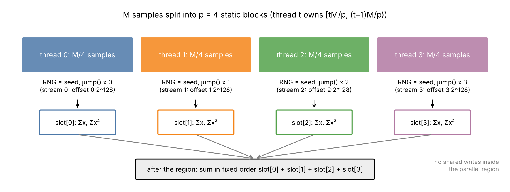{width=62%}

**Correctness.** Serial gives 10.451719 ± 0.001472 (0.77 SE from Black–Scholes), and p = 1 is **bit-identical** to
serial. The same seed and p always give bit-identical results. p = 2 and 4 land 0.83 and 0.73 SE from the reference.
Tolerance: 3 SE.

| version | p | median (s) | min (s) | S(p) median | S(p) min |
|---|---|---|---|---|---|
| serial | 1 | 4.362 | 4.261 | 1.00 | 1.00 |
| parallel | 2 | 3.110 | 3.051 | **1.40** | 1.40 |
| parallel | 4 (HT) | 2.568 | 2.367 | **1.70** | 1.80 |

*Median of 9 interleaved runs.*

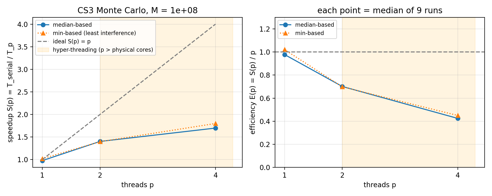{width=70%}

**Q1 RNG.** One shared generator in `omp critical` ran at **8.95 M samples/s, 2.6× slower than serial** (23.5 M/s):
every draw serializes, and the state and lock bounce between cores. Same seed in every thread: the threads replay
one stream, so 10⁸ "samples" are 4 copies of 2.5·10⁷. We proved this by showing the price is bit-identical to
`./serial 25000000 42`. The reported SE (0.00147) is **2× = √p too small**, a silent error.

**Q2 Statistical vs parallel efficiency.** SE ∝ 1/√M, so at a fixed time budget SE_p/SE₁ = 1/√S. We ran each p with
M_p = 10⁸ × T_serial/T_p, so that all finished in ≈ 4.4 s. **4 threads reduced the error only 1.33× (= √1.76)**:
0.0014574 → 0.0010971. Halving the error needs 4× the samples, i.e. S = 4.

**Q3 Why not ≈ 2.0?** The code's serial fraction is < 10⁻⁵ (start-up, p jumps, a p-term sum), and imbalance is ≤ 1.013,
yet Karp–Flatt gives f ≈ 0.43. That figure is not serial code but hardware: (i) the 15 W chip lowers its turbo clock
when both cores are busy; (ii) hyper-threading p = 2 → 4 adds only 1.21–1.29× (shared FP units); (iii) under WSL2,
`OMP_PLACES` pins threads to *virtual* CPUs only. An earlier run with both threads deliberately pinned to one virtual
core also gave S(2) = 1.40, so Hyper-V, not our binding, decides the physical placement.

**Q4 Reproducibility.** Same seed and p: bit-identical. Changing p changes the price by ≈ 10⁻⁴ (≈ 0.1 SE), because each
p uses a different stream assignment. Our `assoc` test sums the *same* 10⁸ samples in 1, 2, 4 or 8 groups: the price
differs by only 1–2·10⁻¹², so floating-point non-associativity is real but 10⁸× smaller.

# 5. Case Study 4 — PageRank (OpenMP)

**Problem.** PageRank with d = 0.85 and ‖Δr‖₁ < 10⁻⁹ (24 iterations). Dangling rank is spread uniformly. The input is
an **R-MAT** graph (Chakrabarti et al.; Graph500 parameters 0.57/0.19/0.19/0.05, scale 20, seed 2026):
**n = 1 048 576, m = 16 085 679**, maximum in-degree 39 615, 47.9% dangling. It is stored in CSR in both directions.
Within an iteration all vertex updates are independent.

**Decomposition.** Over vertices. **Pull:** threads own destinations and gather from in-neighbours (only shared
reads, no synchronization). **Push:** threads own sources and scatter with `omp atomic`. The edge loop uses
`schedule(runtime)`. Per-thread time and edge counts give the imbalance ratio R.

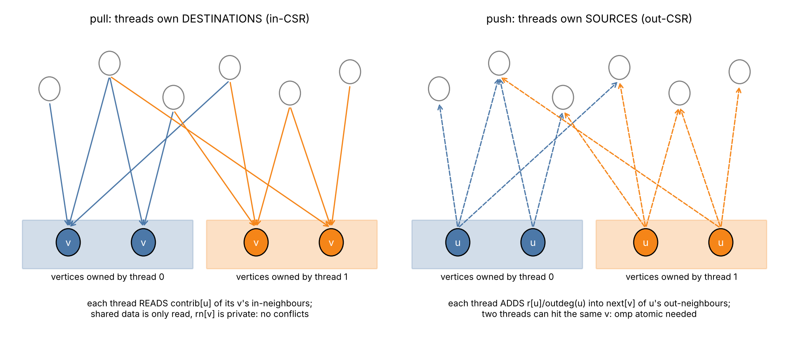{width=75%}

**Correctness.** L1 distance to the serial ranks < 10⁻⁹: pull and push ≤ 9.1·10⁻¹³, **PASS** for every p and
schedule. Push *without* atomics fails at p ≥ 2 (L1 = 2–3·10⁻³) and never converges.

| version, schedule | p = 1 | p = 2 | p = 4 | R (p = 4) |
|---|---|---|---|---|
| serial pull | 2.713 s | – | – | – |
| pull, static | 2.502 | 2.222 (S 1.22) | 1.904 (S 1.42) | 1.783 |
| pull, dynamic,256 | 2.531 | 1.998 (S **1.36**) | 1.793 (S **1.51**) | 1.011 |
| push, dynamic,256 | 7.100 | 4.918 (S 0.55) | 4.823 (S 0.56) | 1.001 |

*Median of 5 runs; best rate 215 M edges/s.*

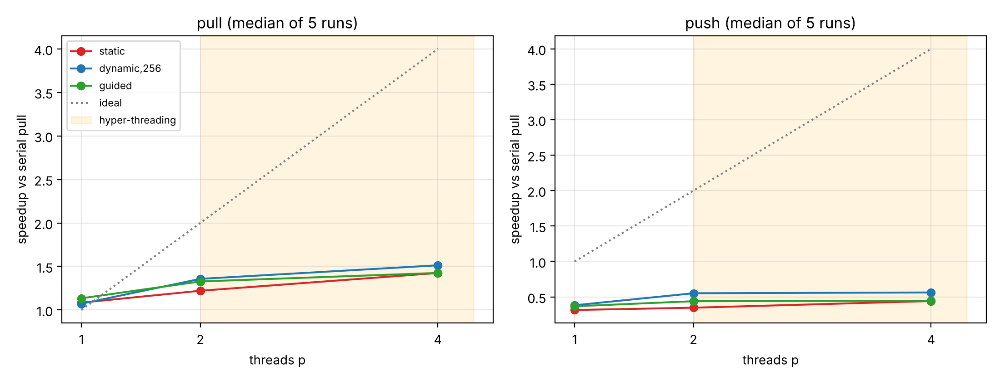{width=49%} 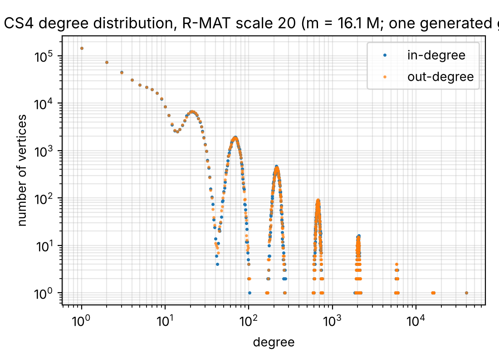{width=37%}

**Q1 Irregularity.** In pull, a vertex's work is its in-degree (0 to 39 615). Under `static`, the busiest thread gets
**1.51× (p = 2) and 2.28× (p = 4)** the mean edges. R-MAT makes this predictable: each destination-id bit is 0 with
probability a + c = 0.76, so the low-id half holds 76% of the edges (0.76/0.5 = 1.52) and the lowest quarter
0.76² = 57.8% (2.31). For the same reason, **`static,64`/`static,1024` do not help** (1.511/2.279): round-robin
ownership is decided by one id bit, which is equally skewed.

**Q2 Scheduling.** At p = 4: static 1.835 s; **dynamic,1 2.619 s** (perfect balance but ≈ 40 ns per chunk grab,
25 M grabs); dynamic,16–16384: 1.60–2.00 s with R ≈ 1.00 (differences within noise); guided 2.07 s (its large first
chunks contain the heaviest vertices, R = 1.12). **Best: dynamic with c ≈ 256–1024**, small enough to balance and few
enough grabs (n/c per iteration) to cost nothing.

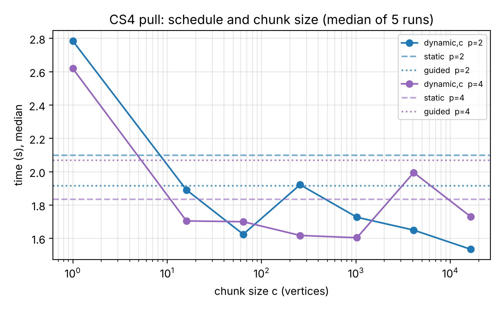{width=55%}

**Q3 Atomics.** At p = 1: pull 6.48 ns/edge; push without atomic 7.33; **push with atomic 18.08 ns/edge (+147%)**. A
`double` atomic add compiles to a `lock cmpxchg` retry loop (verified in the assembly). The `lock` is a full fence,
so the scatter's cache misses can no longer overlap. With threads, push's random read-modify-writes need exclusive
cache lines, and hot destinations ping-pong between cores. Pull only shares lines read-only. Push stays 2.7× slower
at p = 4.

**Q4 Memory.** Pull moves ≈ 8.7 B/edge (4 B index, ≈ 4.7 B per-vertex arrays amortized) if every contrib[u] gather
hits in cache, and ≈ 73 B/edge if every gather misses: 1.9–15.6 GB/s at 215 M edges/s. Serial needs only 6.5 ns per
edge, against ≈ 29 ns for a measured random DRAM access, so most gathers hit (power-law sources are reused). We
estimate ≈ 13% misses, about 17 B/edge ≈ 3.7 GB/s, **a quarter of the bandwidth**. The kernel is latency-bound on the
missing gathers and limited by the 3 MiB L3 (contrib is 8 MiB). It is not bandwidth-bound.

# 6. Case Study 5 — Distributed Sample Sort (MPI)

**Problem.** Sort N = 10⁸ 32-bit keys, of which each rank generates N/p (seed per rank) and never holds the whole
array. Inputs: **uniform**, and **Zipf(1.5)** over 2²⁰ values (key 0 ≈ 38% of all keys). Sample sort reduces sorting
to independent local sorts plus one all-to-all.

**Algorithm.** (1) local `qsort`; (2) ov·p − 1 regular samples per rank → `MPI_Gather` → p − 1 splitters at the global
positions (j+1)/p → `MPI_Bcast`; (3) binary-search partition; (4) `MPI_Alltoall` counts + `MPI_Alltoallv` keys;
(5) pairwise merge of the p runs. Splitters are **(key, rank, position)** triples, so a run of equal keys can be split
between ranks. An optional radix local sort shows how the phase balance changes.

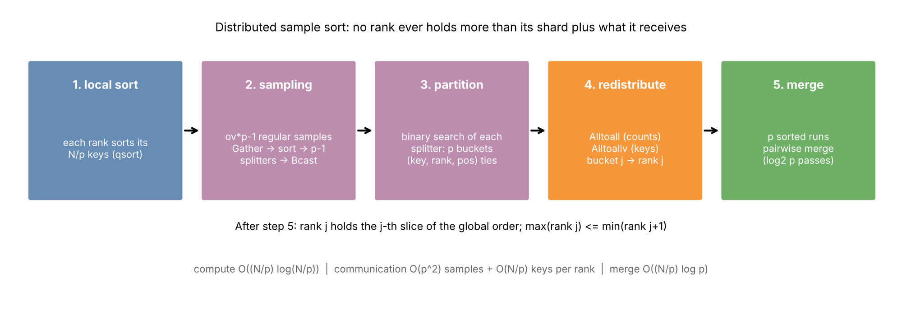{width=80%}

**Correctness.** Per run: each rank sorted; max of the lower ranks ≤ my min (`MPI_Exscan`); the count equals N; the
multiset fingerprint (sum of hashed keys) is unchanged. **All runs PASS** (12/12 in `make check`, every benchmark run).

**Q1 Load balance.** Final counts per rank at p = 4:

| input, splitters | ov = 1 | ov = 256 | max/mean: ov = 1 → 4 → 16 → 64 → 256 |
|---|---|---|---|
| uniform | 24.998 M, 25.002 M, 25.003 M, 24.997 M | identical | 1.000 throughout |
| Zipf, key only | **38.30 M**, 13.55 M, 23.37 M, 24.78 M | identical | **1.532 throughout** |
| Zipf, key+rank+pos | 25.40 M, 22.60 M, 26.81 M, 25.18 M | 24.98 M, 25.03 M, 24.97 M, 25.01 M | 1.073 → 1.040 → 1.007 → 1.008 → **1.001** |

*Uniform shards are iid, so p − 1 regular samples are already exact quantiles. With key-only splitters, all copies of
key 0 (38.3%) must go to one rank, so max/mean ≥ 0.383/0.25 = 1.53 whatever the sampling. Tie-breaking removes that
floor, and oversampling then refines the cut points inside the long runs (error ∝ 1/samples), at < 0.02 s cost.*

**Q2 Phases** (median of 3 runs, barrier-to-barrier):

| input, local sort | p | total (s) | local sort | sampling + partition | Alltoall(v) | merge |
|---|---|---|---|---|---|---|
| uniform, qsort | 2 / 4 | 19.97 / 19.65 | **19.20 / 18.21** | 0.000 / 0.001 | 0.246 / 0.171 | 0.635 / 0.583 |
| zipf, qsort | 4 | 12.05 | **11.41** | 0.000 | 0.239 | 0.402 |
| uniform, radix | 2 / 4 | 2.60 / 3.11 | **1.53** / 1.74 | 0.000 / 0.031 | 0.301 / 0.342 | 0.763 / **1.321** |

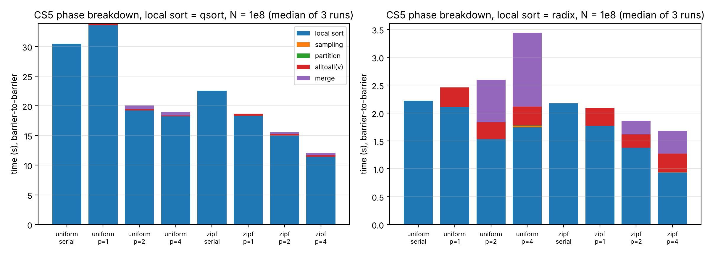{width=100%}

With qsort, the local sort dominates at every p (93–99%). With a cheap local sort (radix, 10–14× faster), the **O(N)
data-movement phases take over as p grows**: merge + Alltoallv rise from 41% of the time at p = 2 to 54% at p = 4
(1.66 s vs 1.74 s for the sort). The merge does log₂ p passes, and at p = 4 two ranks share each core.

**Q3 α–β model.** Ping-pong gives **α = 0.29 µs and β = 0.2125 ns/B (4.71 GB/s)**, with a clear eager→rendezvous jump
between 1 KiB (0.60 µs) and 4 KiB (3.88 µs). For the busiest rank's 95.4 MiB at p = 2, the model predicts
(p−1)α + β·m = **0.021 s against 0.22–0.30 s measured (10–21× low)**. The cause shows up at p = 1, where no byte
crosses between ranks, yet the phase still takes **0.29–0.35 s**. That is page-faulting and zeroing the fresh receive
buffer, plus copying the rank's own bucket, which the warm-buffer ping-pong never sees: 0.78 ns per received byte.
Adding this term predicts 0.18 s at p = 2 (**within 1.2–1.7×**) and 0.09–0.10 s at p = 4 (1.8–3.6× low: all ranks
copy at once over one memory bus, two per core).

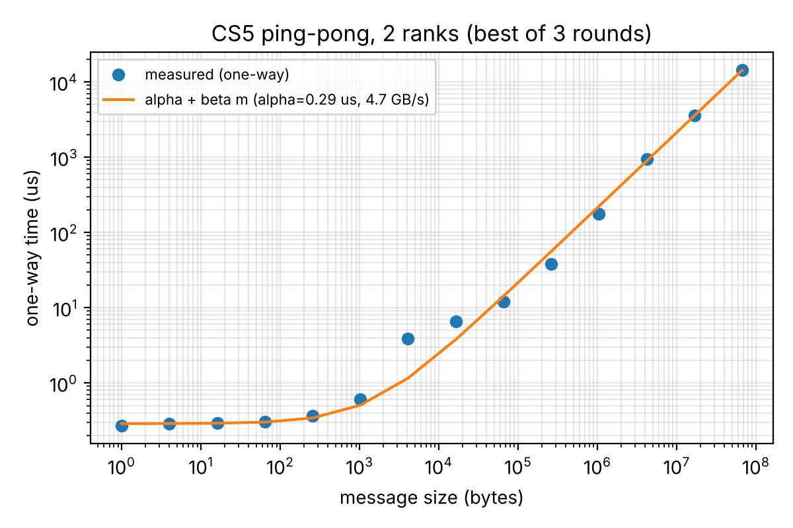{width=48%} 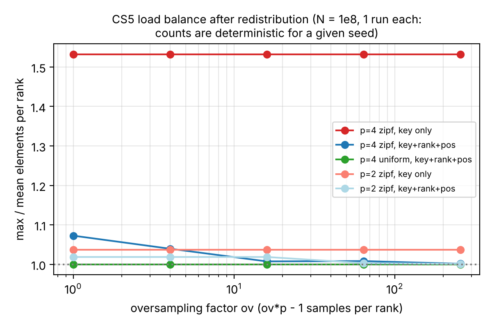{width=48%}

**Q4 vs. a single-process sort.** With qsort: uniform 30.48 → 19.65 s (**1.55×**), Zipf 22.56 → 12.05 s (1.87×). The
local-sort work alone would allow p·log N/log(N/p) = 2.08 at p = 2, but (i) only 2 physical cores exist and they slow
down together (the qsort phase gained 1.59×), and (ii) sample sort adds **O(N) data movement the serial sort never
does** (redistribution + log₂ p merge passes: 0.4–1.6 s). With radix, the sort itself is only a few linear passes,
so this overhead equals the sort and **sample sort is slower than serial (0.85×, 0.71×)**: O(N log N) computation
parallelizes, O(N) data movement on one memory bus does not.

# 7. Cross-case Comparison

| case | model | best speedup (p) | dominant bottleneck | evidence |
|---|---|---|---|---|
| CS1 heat | MPI | 1.28 (2), N = 1024 | **memory bandwidth** | compute phase does not shrink with p; 608 M updates/s ≈ 14.6 GB/s ≈ machine bandwidth |
| CS2 k-mer | OpenMP | 1.70 (4), k = 8 private | **cache capacity / synchronization** (k = 8); **memory latency** (k = 12) | atomics 5–6× slower at k = 8; 33 M/s ≈ 35 M/s random-update ceiling at k = 12 |
| CS3 Monte Carlo | OpenMP | **1.70 (4)**, 1.40 (2) | **compute: clock frequency + hyper-threading** | f_code < 10⁻⁵ but Karp–Flatt 0.43; HT adds 1.21–1.29× |
| CS4 PageRank | OpenMP | 1.51 (4), pull dynamic | **load imbalance** (static), then **memory latency** | static edge imbalance 2.28 (predicted 2.31); atomics +147% |
| CS5 sample sort | MPI | 1.87 (4), Zipf qsort | **compute** (qsort); **data movement** (radix) | qsort 93–99% of time; radix version slower than serial |

**Which scaled best, and why.** **CS3 (Monte Carlo)** scaled most cleanly (1.40 on 2 cores, 1.70 with HT, median and
minimum in agreement). It is the only compute-bound case with no shared data, no communication and perfect balance,
so its losses are purely hardware: the clock drop when both cores run, and the limits of hyper-threading. CS5 with
Zipf reached a higher raw number (1.87), partly from noise in its 22.6 s serial median. CS2 at k = 8 and CS4 (pull)
scaled moderately once synchronization and imbalance were removed. **CS1 scaled worst**, because a stencil streams
memory and one laptop has one memory bus. The common lesson is that on a 2-core, 1-socket machine, **the memory
system, not the core count, decides which codes scale**: every bandwidth- or latency-bound case stalls near 1–1.5×
however well it is decomposed.

# 8. Individual Contributions and Use of AI Tools

Group 02 has one member. **Asad Usman (23L-0740)** was lead *and* reviewer for all five case studies. With no
partner, the lead/reviewer split of Section 7 of the brief does not apply. He set up the environment
(Ubuntu/WSL2, GCC 15, Open MPI 5, the private GitHub repository), ran every build, correctness check and benchmark
on his own laptop, made the methodological decisions (e.g. measuring the laptop in its default power state), and
reviewed and committed all files. Details and hours are in `CONTRIBUTIONS.md`.

**Use of AI tools.** With the TA's permission, an AI assistant (Claude, by Anthropic) was used to draft code,
benchmark scripts and report text, and to help interpret the measurements. All experiments and numbers come from
runs on the machine in Section 1. The raw logs and scripts to regenerate every table and graph are in the repository.

# 9. References

1. MPI Forum, *MPI: A Message-Passing Interface Standard, Version 4.0*, 2021.
2. OpenMP ARB, *OpenMP Application Programming Interface, Version 5.2*, 2021.
3. D. Blackman, S. Vigna, "Scrambled linear pseudorandom number generators," *ACM TOMS* 47(4), 2021.
4. F. Black, M. Scholes, "The pricing of options and corporate liabilities," *J. Political Economy* 81(3), 1973.
5. G. E. P. Box, M. E. Muller, "A note on the generation of random normal deviates," *Ann. Math. Stat.* 29(2), 1958.
6. A. H. Karp, H. P. Flatt, "Measuring parallel processor performance," *CACM* 33(5), 1990.
7. D. Chakrabarti, Y. Zhan, C. Faloutsos, "R-MAT: A recursive model for graph mining," *SIAM SDM*, 2004; Graph500 benchmark specification (R-MAT parameters).
8. L. Page, S. Brin, R. Motwani, T. Winograd, "The PageRank citation ranking," Stanford tech. report, 1999.
9. H. Shi, J. Schaeffer, "Parallel sorting by regular sampling," *JPDC* 14(4), 1992.
10. R. W. Hockney, "The communication challenge for MPP," *Parallel Computing* 20(3), 1994 (α–β model).
11. S. Williams, A. Waterman, D. Patterson, "Roofline," *CACM* 52(4), 2009.
12. Intel, *64 and IA-32 Architectures Optimization Reference Manual* (prefetchers, false sharing); Open MPI documentation (shared-memory transport, eager/rendezvous protocols).

*Datasets:* all inputs are synthetic and generated by the code (seeds stated per case study); no external datasets
were used.
